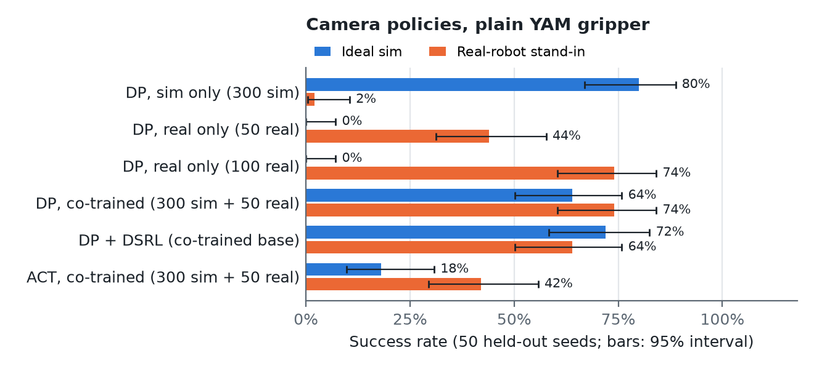
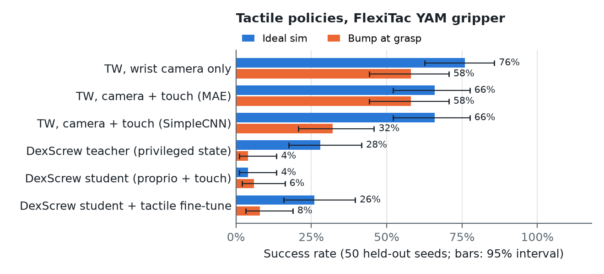
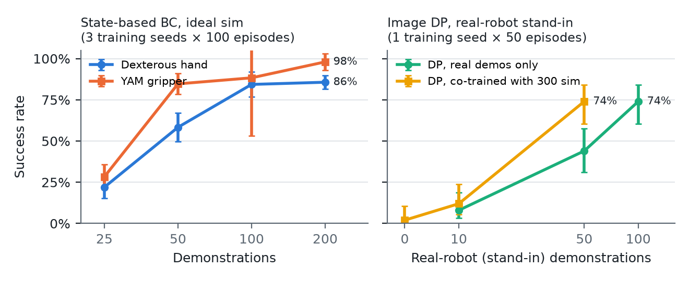
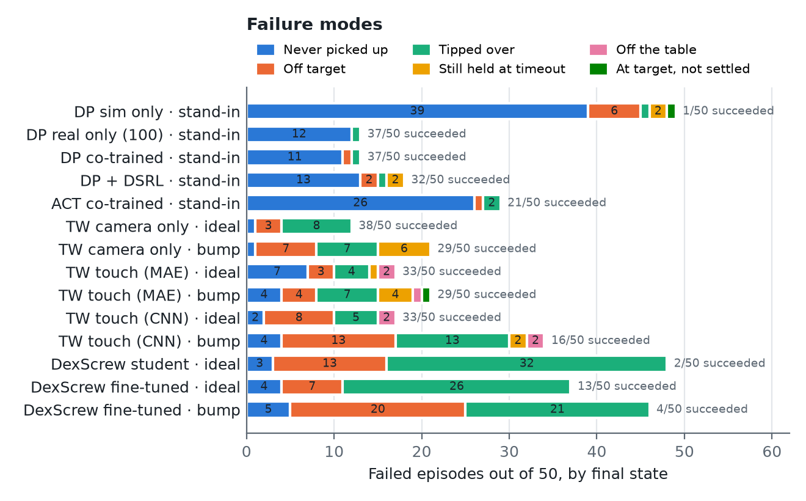

# ADAM-U Nut Pick-and-Place: Policy Comparison and Deployment Recommendation

*code: github.com/josyulakp/adamu-nut-policies · models: huggingface.co/josyula/adamu-nut-policies*

## Summary

I compared five policy-learning methods in MuJoCo on a single task: the right arm of a PNDbotics ADAM-U picks up a
22 mm hex nut lying flat on a table and sets it upright on a target pad.

I first tried the task with ADAM-U's five-finger hand, but the results were not satisfactory, so I replaced the hand
with a YAM parallel-jaw gripper. With the same state-based behaviour cloning, the gripper did clearly better: 85%
success from 50 demonstrations against 58% for the hand, and 98% against 86% from 200.

The policies fall into two groups:

- **Camera only:** Diffusion Policy (DP), DP + DSRL and ACT.
- **Touch-based:** Touch in the Wild (camera + touch) and DexScrew (proprioception + touch).

To test whether a policy trained in simulation could transfer to the real robot, I built a "real-robot stand-in": a
second simulator that differs from the training one the way a real robot would, in appearance, camera calibration,
latency, servo response, and the nut's mass and friction. The camera policies were trained on randomised simulation
demos mixed with a few stand-in demos, and evaluated in the stand-in. I also added a "bump" condition, in which the
nut is pushed 3 cm sideways just as the gripper closes, to test whether a policy can recover from a failed grasp.

**For the real robot I recommend the co-trained Diffusion Policy (300 sim + about 50 real demos) on the plain YAM
gripper.** It was the only policy that stayed strong under a sim-to-real shift: 74% against 2% for sim-only
training. It also needed half the real demos of a real-only policy. Tactile sensing (FlexiTac) did not improve
success in my tests.

## AI disclosure

I used Claude Opus 5.5 (Anthropic) throughout this work. It helped me write the simulation environments, the gripper
modifications, the scripted controllers that generated the demonstrations, and the training and evaluation code, and
it ran the experiments and collected the results. All demonstrations come from scripted controllers in simulation; no
human teleoperation data was used.

## Setup

Nut pose and target position are random per episode. An episode succeeds when the nut ends within 20 mm of the pad
centre, upright, released and still for 0.5 s, within 15 s.

**Methods.**

- **Camera policies, plain YAM gripper.** Head and wrist RGB plus joint angles. Methods: Diffusion Policy (DP), ACT,
  and DP + DSRL (RL steers the frozen DP's noise).
- **Tactile policies, FlexiTac YAM gripper** (two pads of 32 × 12 taxels).
    - Touch in the Wild (TW): wrist camera + touch, with a SimpleCNN or visuo-tactile MAE encoder.
    - DexScrew: privileged teacher, proprioception + touch student, and tactile fine-tune.

**Evaluation.** Every policy is evaluated on the same 50 held-out seeds, never used in training. The bars in the
figures are 95% Wilson intervals, about ±12–14 points at 50 episodes, so differences under about 15 points are not
significant. Each image policy was trained once (one training seed), so the intervals cover evaluation noise only, not
retraining variance. The behaviour-cloning curves in Figure 3 use 3 training seeds.

| Condition | What changes |
|---|---|
| Ideal | Nominal simulator, nothing randomised |
| Real-robot stand-in | Unseen look, camera offset, image noise, 150 ms latency, softer servos, lower friction, heavier nut |
| Bump | Nut pushed 3 cm sideways as the gripper closes |
| Shifted physics | Heavier nut, lower friction, 80% arm gains, 2-step latency |

## Results

**Figure 1. Camera policies.**

- **Sim-only DP does not transfer:** 80% in the ideal sim, 2% in the stand-in.
- **Real-only DP works only in its own domain:** 0% in the ideal sim.
- **Co-training with 50 real demos reaches 74% in the stand-in.** That matches real-only with 100 demos and beats
  real-only with 50 (44%), while keeping 64% in the ideal sim.
- **DSRL did not beat its base policy** (64% against 74%), and **ACT was weaker throughout.**

**Figure 2. Tactile policies.**

- **Touch did not beat camera-only TW:** 76% against 66% in the ideal sim, and 58% for both under the bump.
- **The encoder matters under disturbance:** the SimpleCNN touch encoder dropped to 32% with the bump.
- **DexScrew was the weakest method:** 4% for the student, 26% after the tactile fine-tune, and 8% or less under the
  bump. Even its privileged teacher, which sees the exact nut pose, reached only 28%, although the scripted expert it
  imitates succeeds 96.5% of the time. The teacher is the bottleneck, and the students cannot do better than it.
- In the shifted-physics condition the fine-tune helped (16% against 10% for the student), but the teacher reached 58%.

**DexScrew correction.** An earlier version of these results was invalid. A bug in its environment reset the nut to
the same start position (and the arm to its zero pose) in every episode, which made its task easier than the other
methods'. The numbers above come from a full re-run (teacher, student and fine-tune) after the fix.

**Figure 3. Success against number of demonstrations.**

- **State-based behaviour cloning (left):** the gripper learns faster than the five-finger hand. It reaches 85% from
  50 demos (hand 58%) and 98% from 200 (hand 86%).
- **Image DP in the stand-in (right):** real-only DP needs 100 stand-in demos to reach 74%; co-training with the 300
  sim demos reaches the same with 50.
- **Neither works with 10 real demos** (8–12%). The 300 sim demos alone give 2%.
- Not measured yet: co-training with 100 real demos, and varying the number of sim demos.

**Figure 4. Failure modes**, classified from the nut's final state (position, tilt, height) against its start.

- **Camera policies mostly never pick the nut up:** 11 of the co-trained DP's 13 failures and 26 of ACT's 29. These
  episodes are mostly missed or never-completed grasps.
- **Touch in the Wild failures are spread out:** most often the nut is tipped over during placement, or released off
  target. Under the bump, more episodes end still holding the nut.
- **The SimpleCNN encoder** fails mainly by placing off target and tipping the nut under the bump.
- **DexScrew mostly tips the nut over** (26 of the fine-tuned student's 37 failures). Its episodes end early when the
  nut tilts past 45° or leaves the table, and it records no final height, so "still held" cannot be told apart.
- Final states cannot tell a missed grasp from a policy that never reached the nut; the recorded rollout videos are
  needed for that, and future runs should log grasp and release events.

## Recommendation

**Deploy the co-trained Diffusion Policy with the plain YAM gripper.**

- It is the only recipe shown to survive a large domain shift.
- It is the most data-efficient: 50 real demos match 100 real-only demos.
- It needs only two RGB cameras and joint encoders, and the task is mainly visual.

**Defer FlexiTac.** It added no measurable success in simulation, even under the bump. It also brings mounting,
calibration and synchronisation work, and simulated touch has no shear or slip, so the sim-to-real gap is larger than
for images. Add it if real failures turn out to be contact failures (slips, unnoticed failed grasps) or if the task
becomes contact-rich. In that case use TW with the MAE encoder, co-trained with real tactile demos, against a
camera-only twin.

**Plan.**

1. Record about 50 teleoperated demos with matched cameras and 20 Hz control.
2. Co-train with the sim demos (α = 0.5).
3. Evaluate on 20–50 real trials.
4. If success is too low, add real demos before trying DSRL.

**Caveats.**

- **The "real robot" is a simulated stand-in:** these results rank recipes by robustness to domain shift, not by
  hardware success rates.
- **The camera policies' main failure is never picking the nut up.** If that holds on hardware, grasp verification
  from touch becomes the strongest argument for adding FlexiTac.
- **Re-running the DSRL evaluation** gave the same success rates (64% stand-in, 72% ideal) with a few different
  seeds succeeding: evaluation on the GPU is not bit-for-bit deterministic.
